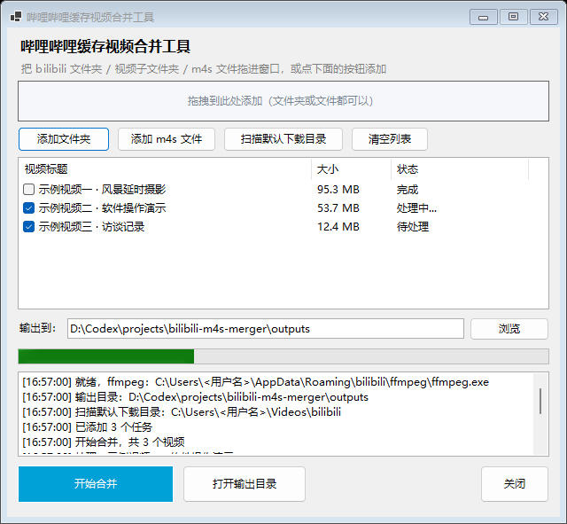

# B站缓存视频合并工具 · bilibili-m4s-merger

> 把哔哩哔哩 Windows 客户端下载的 m4s 分片，一键无损合并成可直接播放的 MP4。



## 这工具解决什么问题

B 站 Windows 客户端下载完视频后，得到的**不是** mp4，而是「音视频分离」的 m4s 分片：

```
C:\Users\<你>\Videos\bilibili\842016686\
├── 842016686-1-30080.m4s    ← 视频流（88 MB）
├── 842016686-1-30280.m4s    ← 音频流（7 MB）
├── videoInfo.json           ← 标题等元数据
└── image.jpg                ← 封面
```

而且每个 m4s 文件**开头还带 9 个 `0x30`（字符 "0"）字节的垃圾前缀**，所以：

- 双击打不开
- 拖进播放器黑屏 / 没声音
- 导入剪映、Premiere、达芬奇直接不认
- 甚至 ffmpeg 直接读也会报错

本工具负责把这些分片合并成一个**标准 MP4**。

## 特性

- **图形界面**：双击即用，不需要敲命令
- **支持拖拽**：整个 `bilibili` 文件夹、单个视频子文件夹、或几个 `.m4s` 文件，拖进窗口就行
- **自动识别流类型**：读文件头里的 `vide` / `soun` 标记，不靠猜文件名
- **自动剥离前缀**：只在确认是 9 个 `0x30` 时才剥，不会误伤正常 mp4
- **无损**：用 `ffmpeg -c copy` 只重新封装，**不重新编码**，画质零损失
- **极快**：100 MB 的视频约 1 秒完成（固态硬盘）
- **自动命名**：读取 `videoInfo.json` 里的标题作为文件名，并自动过滤 Windows 非法字符
- **防重复**：已合并过且大小一致的会自动跳过，重复点也不会重复劳动
- **免装 ffmpeg**：会自动找到 B 站客户端自带的那份
- **输出通用格式**：H.264 + AAC 的 MP4，剪映 / PR / DaVinci 直接导入

## 使用方法

1. 下载本仓库（`Code` → `Download ZIP`，或 `git clone`）
2. 解压后双击 **`启动B站视频合并.cmd`**
3. 程序启动时自动扫描 `C:\Users\<你>\Videos\bilibili`，把已下载的视频列出来并勾选
4. 确认勾选 → 点 **「开始合并」**
5. 结果默认输出到程序同级的 `outputs` 文件夹（可在界面上改，会记住）

也可以把视频文件夹直接拖进窗口，或用「添加文件夹」按钮。

## 系统要求

- Windows 10 / 11
- Windows PowerShell 5.1（系统自带，无需安装）
- ffmpeg：**绝大多数情况不用手动装**

程序按以下顺序自动查找 ffmpeg：

1. 上次记住的位置（`settings.json`）
2. 程序同目录下的 `ffmpeg.exe`
3. **B 站客户端自带的** `%APPDATA%\bilibili\ffmpeg\ffmpeg.exe` ← B 站用户通常命中这条
4. WinGet / Chocolatey 的安装位置
5. 系统 `PATH` 里的 ffmpeg

全都找不到时会弹窗让你手动指定，并记住位置。

## 工作原理

四个步骤：

1. **剥离前缀** —— 检测文件开头 9 个字节是否全为 `0x30`，是则跳过
2. **识别流类型** —— 读文件头 256 KB，查找 MP4 的 `hdlr` box 标记（`vide` 表示视频流，`soun` 表示音频流）
3. **无损封装** —— `ffmpeg -i video -i audio -c copy -movflags +faststart out.mp4`
4. **命名落盘** —— 用 `videoInfo.json` 的标题命名，写到输出目录

因为第 3 步是 `-c copy`（流复制）而不是转码，所以画质不会有任何损失，速度也基本只受磁盘读写限制。

## 常见问题

**Q: 合并出来没有声音？**
A: 说明只合并了视频流。检查该视频目录里是否有第二条 m4s（音频流）。如果确实只有一条，那这个视频本身就没有音轨。

**Q: 能合并手机端的缓存吗？**
A: 手机端缓存是 `video.m4s` + `audio.m4s` 的结构，理论上把那个目录拖进来也能识别（同样是读文件头判断流类型）。但本项目主要在 Windows 客户端上测试过，手机端请自行验证。

**Q: 双击 `.cmd` 报错说找不到脚本？**
A: `启动B站视频合并.cmd` 和 `B站视频合并.ps1` 必须放在**同一个文件夹**里，`.cmd` 是靠同目录查找来找主程序的。另外这个文件夹里不要放其他 `.ps1` 文件。

**Q: 提示"无法加载文件，因为在此系统上禁止运行脚本"？**
A: 启动器已经带了 `-ExecutionPolicy Bypass` 参数，正常不会遇到。如果仍然报错，可以在 PowerShell 里执行：`Set-ExecutionPolicy -Scope CurrentUser RemoteSigned`。

**Q: 输出目录里出现 `xxx (2).mp4`？**
A: 说明同名文件已存在但大小不一致，程序没有覆盖，而是另存了一份。

**Q: 会修改我原来下载的文件吗？**
A: 不会。源文件只读不写，程序只在自己的 `work` 目录里生成临时文件，合并完自动删除。

## 免责声明

本工具只处理**你本机已经下载好**的缓存文件，不提供下载、解析、破解、绕过任何平台限制的功能，也不访问网络。

请在遵守哔哩哔哩用户协议及相关法律法规的前提下使用。请勿将本工具用于传播盗版内容或任何商业用途。

## 开源协议

[MIT](LICENSE)